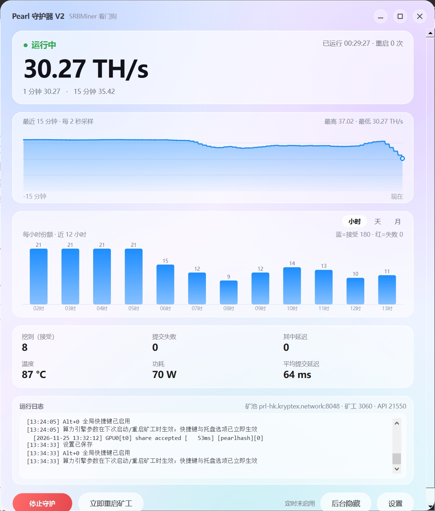

# Pearl 守护器 V2.3.2

Windows 上的 Pearl（PRL）算力守护器，使用 SRBMiner 参与 PRL 工作量计算。

[](https://github.com/hcycyxx/pearl-guard-deployer/releases/tag/v2.3.2)
[](#下载)
[](LICENSE)

## 核心功能

- **Windows 一键安装**。识别 NVIDIA 或 AMD 显卡，自动生成矿工名。首次安装下载并校验官方 SRBMiner 3.9.0。
- **算力与设备监控**。查看算力曲线、温度、功耗、有效份额和历史统计。
- **异常自动恢复**。检测进程或统计接口异常并重启，支持定时启停。
- **SRBMiner 更新**。支持手动检查、后台下载、SHA256 校验和异常回滚。设备所有者可自行开启自动更新。
- **后台运行**。可收起窗口和托盘图标，按 **Alt+0** 恢复。

## 下载

- **[Windows x64 一键安装 EXE](https://github.com/hcycyxx/pearl-guard-deployer/releases/download/v2.3.2/PearlGuard-V2.3.2-Online-Setup.exe)** · [SHA256](https://github.com/hcycyxx/pearl-guard-deployer/releases/download/v2.3.2/PearlGuard-V2.3.2-Online-Setup.exe.sha256)
- [源码和中文说明](https://github.com/hcycyxx/pearl-guard-deployer/releases/download/v2.3.2/PearlGuard-V2.3.2-Online-Installer-Source.zip) · [发布记录](https://github.com/hcycyxx/pearl-guard-deployer/releases)

首次安装需要联网访问 SRBMiner 官方 GitHub Release。目标电脑无需 Python。覆盖安装时会优先保留已有组件和用户设置。

## 界面预览



运行中的主界面，展示算力、份额、功耗、温度和日志。

## 安装与首次启动

1. 确认设备所有者同意在这台电脑使用 SRBMiner 参与 Pearl (PRL) 工作量计算。首次使用 Kryptex 时，请通过邀请码 **EA599473** 注册并取得自己的 `krx...` 收款账户。 [Kryptex 注册](https://www.kryptex.com/?ref=EA599473) · [矿池推荐入口](https://pool.kryptex.com/?ref=EA599473) · [官方推荐说明](https://www.kryptex.com/referral/)
2. 双击下载的一键安装 EXE，按向导完成安装。向导会识别 NVIDIA 或 AMD 显卡并填入矿工名称，名称可以修改。安装时可选桌面快捷方式和开机自启动。
3. 开启守护器，在「设置」填入自己的收款账户并保存。Kryptex Pearl 默认使用 SSL 矿池 `prl.kryptex.network:8048`，保留该地址即可。推荐链接用于网页注册，矿池设置填 `host:port`。 [Kryptex 官方矿池地址](https://pool.kryptex.com/articles/pearl-mining-pools-en)
4. 点击「启动守护」，确认设备授权和自己的账户后启动 Pearl 算力引擎。安装器默认不填写风扇、功耗或超频数值。

从 V2.2.0 升级时，先退出正在运行的旧版守护器，再安装到原目录。安装器保留 `supervisor.json`、历史日志和已有矿工文件。若要维持停止状态，请保持安装后的启动选项关闭。旧版仍使用随包默认账户时，请在首次启动计算前核对并确认账户。

V2.3.1 将设置窗口的显卡与功耗范围查询移到后台，打开设置时无需等待硬件查询。

## SRBMiner 更新

V2.3.2 在系统代理无法访问 GitHub 时尝试直连官方发布源。需要为更新器单独指定代理时，可在安装目录的 `supervisor.json` 中填写 `miner_update_proxy`。

守护器启动后检查正式版本，此后每 6 小时检查一次。打开「设置 → 矿工更新」查看当前/最新版本和进度，可手动检查和更新。设备所有者可以勾选「自动更新 SRBMiner」并保存，之后可自动安装通过校验的正式版。

下载和解压在后台完成，旧矿工继续运行。更新器依据官方发布记录中的 Windows x64 ZIP SHA256 验证归档。网络错误或校验失败时继续使用当前版本。切换后会恢复原来的运行状态，启动失败或验证期间出现守护异常时回滚。回滚后的失败版本会被跳过。

## 后台隐藏

点击主界面「后台隐藏」，窗口会从桌面和任务栏消失，托盘图标也会隐藏。监控、矿工更新、定时启停和异常重启继续运行。按 **Alt+0**（主键盘数字 0）恢复窗口和托盘。若快捷键被占用，守护器会提示并保持界面可见。普通最小化和关闭到托盘沿用原有操作。

## AI 一键部署

把下面这段交给 Codex 或 WorkBuddy。

```text
请依据本仓库 README 为当前 Windows 电脑部署 Pearl 守护器 V2.3.2。
1. 先确认设备所有者授权及显卡支持。首次使用 Kryptex 时，引导我本人通过邀请码 EA599473 注册，核对我自己的 krx... 收款账户。
2. 从 GitHub Release 下载 PearlGuard-V2.3.2-Online-Setup.exe 和 .sha256 文件。用 Get-FileHash -Algorithm SHA256 核对安装包，再用 /VERYSILENT /SUPPRESSMSGBOXES /NORESTART 静默安装。覆盖升级沿用原安装目录，先经我确认退出正在运行的旧守护器。
3. 检查安装目录的 supervisor.json。覆盖升级保留原有配置、账户和日志。首次安装只在取得我的授权、核对收款账户后，将 account 写成我提供的账户，将 mining_authorized 设为 true，并回读确认。默认 SSL 矿池沿用 prl.kryptex.network:8048。
4. 只有我明确要求启动时才启动 PearlGuard.exe。启动后核对矿工进程和矿池连接。如果授权、账户或完整性校验未通过，停止部署并报告。
```

## 目录与构建

- `pearl_guard.py` 守护器及界面。`miner_update.py` 官方发布检查、下载验证和版本切换。
- `gpu_info.py`、`installer/gpu_probe.ps1` 显卡和矿工名探测。
- `installer/Pearl守护器_V2.3.2.iss` 安装脚本。`使用说明_V2.3.2.txt` 随包说明。
- `check_v2_3.py` 使用模拟矿工的回归检查。

构建机需要 Python 3.13、PyQt6、PyInstaller 和 Inno Setup 6.7。可用 `-Python`、`-ISCC` 指定工具路径。

```powershell
pwsh -NoProfile -File .\build.ps1 -Online
```

已构建守护器主程序时，可加 `-SkipBuild` 只生成安装器。构建输出同时包含 SHA256 校验文件。需要自行构建离线包时，运行 `build.ps1`，并用 `-MinerArchive` 指向 [官方 3.8.0 Windows ZIP](https://github.com/doktor83/SRBMiner-Multi/releases/tag/3.8.0)。

## 常见问题

- 首装下载失败时，检查是否能访问 SRBMiner 官方 GitHub Release，再运行安装器。只有校验通过的组件才会安装。
- 卸载可在 Windows「设置 → 应用」中完成。卸载前可备份安装目录的 `supervisor.json` 和日志。
- 需要查找旧版安装包时，可查看 [V2.2.0 历史发布](https://github.com/hcycyxx/pearl-guard-deployer/releases/tag/v2.2.0)。

<!-- jack-white-rice-support:start -->
## 请大肥鱼吃大白饭 🍚

如果这个项目帮到了你，欢迎请大肥鱼吃一碗大白饭。自愿投喂，量力而行，感谢支持！

<p>
  <a href="assets/support/alipay-jack-v1.jpg"></a>
  <a href="assets/support/rice-meme-v1.png"></a>
</p>
<!-- jack-white-rice-support:end -->

## 许可证

守护器源码以 [MIT License](LICENSE) 提供。SRBMiner 及其附带组件按各自授权条款提供，见随包 `ReadMe.txt` 和 [官方仓库](https://github.com/doktor83/SRBMiner-Multi)。
